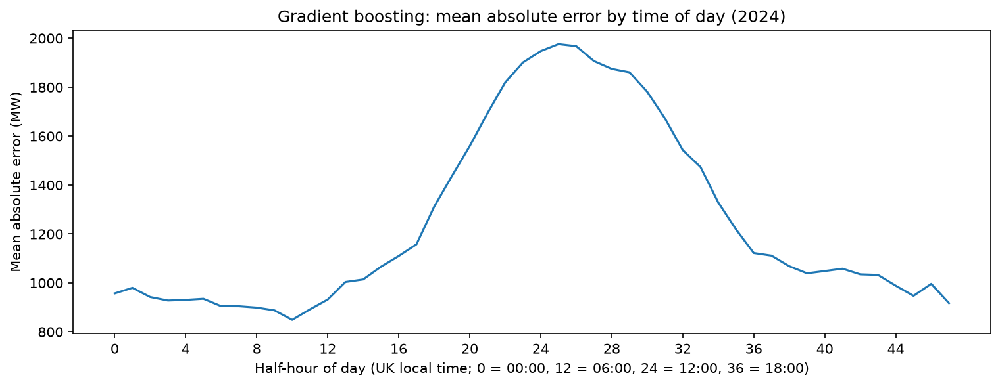

GB Electricity Demand Forecasting

Forecasting half-hourly GB national electricity demand one day ahead, using three years of NESO data. Gradient boosting reduced mean absolute error by **38%** against a same-time-last-week baseline (**1,249 MW vs 2,028 MW**) on a held-out 2024 test set.

Results

All models were scored on 2024 data they never saw during training. Average demand in the test set was about 26,287 MW.

| Model | MAE (MW) | RMSE (MW) | MAE improvement vs baseline |
| Baseline (same time last week) | 2,028 | 2,687 | n/a |
| Linear regression | 1,399 | 1,827 | 31% |
| Gradient boosting | 1,249 | 1,676 | 38% |

Gradient boosting's MAE is about 4.8% of average demand, compared with 7.7% for the baseline.

Data

Historic demand data from the [NESO Data Portal](https://www.neso.energy/data-portal/historic-demand-data), 2022 to 2024, one row per half-hour. The target is `ND` (National Demand). Data files are not included in this repository.

Method

1. **Cleaning.** The yearly files write dates in different formats, so dates are parsed row by row. Settlement periods are converted to timestamps in UTC to handle the 46 and 50 period days when UK clocks change.
2. **Features.** Half-hour of day, day of week, month, a bank holiday flag (England, from the `holidays` package), and demand at the same time yesterday and the same time last week.
3. **Avoiding data leakage.** The forecast is one day ahead, so every lag is at least 24 hours back. A shorter lag would make the scores look much better but would use information that would not be available in practice. Wind, solar and interconnector columns were dropped for the same reason.
4. **Time-based split.** Training uses 2022 and 2023, and testing uses 2024. A random split would let the model learn from days next to the ones it is tested on.
5. **Models.** A same-time-last-week baseline, a linear regression (with one-hot encoded time features), and gradient boosting (`HistGradientBoostingRegressor`, 300 rounds, early stopping off to avoid a random hold-out).

Error analysis

- Normal days: baseline 1,989 MW, gradient boosting 1,244 MW
- Bank holidays: baseline 3,761 MW, gradient boosting 1,457 MW
- Bank holidays roughly double the baseline's error, because last week was a normal day, but add only about 17% to gradient boosting's error, since it has the bank holiday flag.

Limitations

- Only one year (2024) is used for testing, so the scores could differ in another year.
- No weather data was used, although temperature is a major driver of demand.
- The gradient boosting model uses default settings and was not tuned.
- Bank holidays use England's calendar, ignoring small differences in Scotland and Wales, and 2024 has only 8 bank holiday dates, so the holiday results come from a small sample.

Running it
git clone https://github.com/rawdan2006-ai/electricity-demand-forecast.git
cd electricity-demand-forecast
python -m venv .venv
.venv\Scripts\activate
pip install -r requirements.txt

Download the 2022, 2023 and 2024 historic demand CSVs from the NESO link above into a `data` folder, named `demanddata_2022.csv`, `demanddata_2023.csv` and `demanddata_2024.csv`, then open `notebooks/demand_forecast.ipynb` and run all cells.

Possible extensions

Add temperature data, tune the gradient boosting model, test on more than one year, and use regional holiday calendars.
